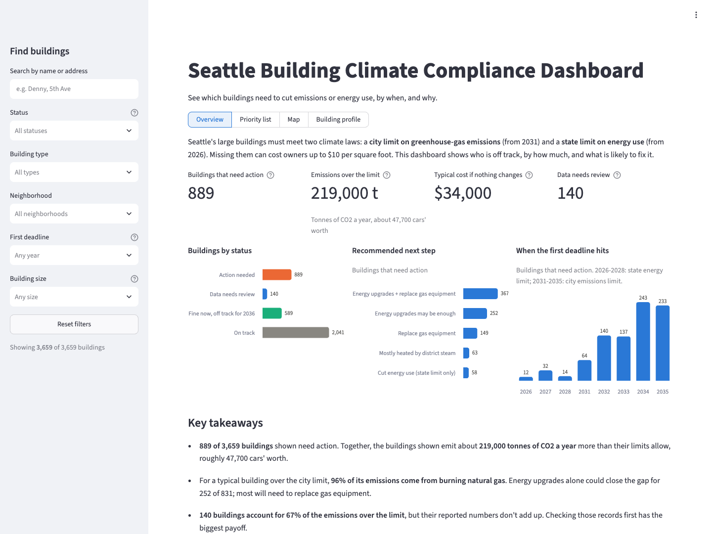
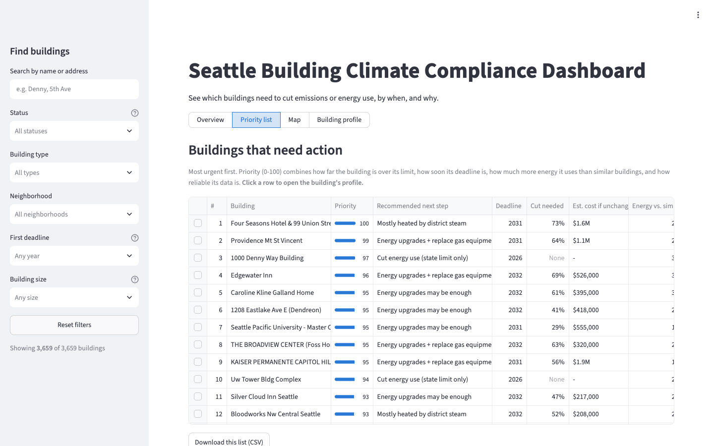
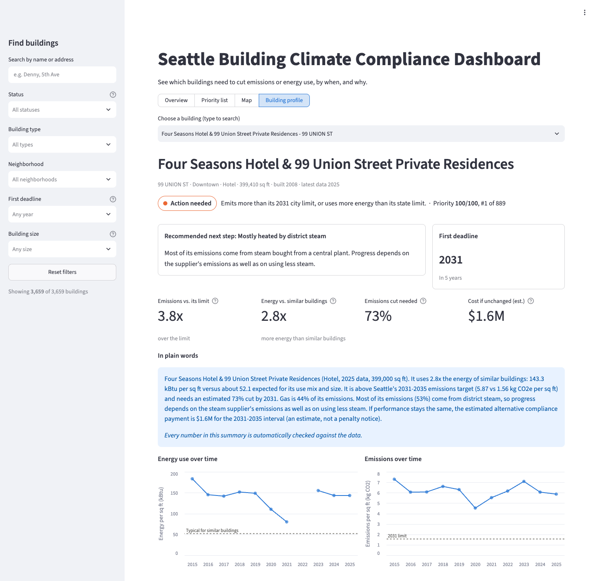
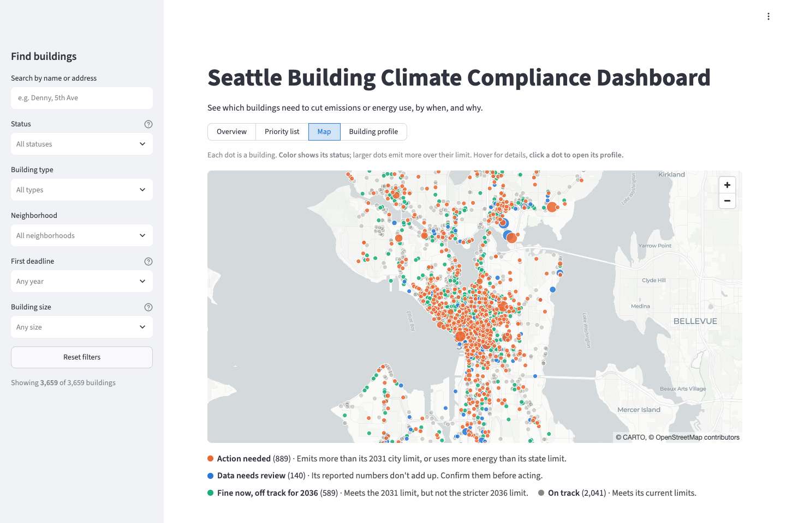
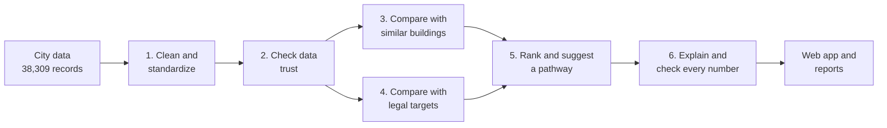

# Seattle Building Decarbonization Prioritizer

**Which of Seattle's ~3,600 large buildings should get help cutting emissions first, and why.**

Seattle's large buildings face two new laws that cap their emissions and energy use,
with deadlines starting now and penalties of up to $10 per square foot. This project
turns the city's public building data into a ranked, explained action list: who is off
track, by how much, what it could cost them, what the likely fix is, and whether the
underlying data can be trusted.



## Contents

1. [At a glance](#at-a-glance)
2. [The real-world problem](#the-real-world-problem)
3. [Users and the decision they make](#users-and-the-decision-they-make)
4. [What the product does](#what-the-product-does)
5. [Key findings and business value](#key-findings-and-business-value)
6. [How it works](#how-it-works)
7. [How we know the results are reliable](#how-we-know-the-results-are-reliable)
8. [Data sources](#data-sources)
9. [Regulatory reference](#regulatory-reference)
10. [Plan and status](#plan-and-status)
11. [Getting started](#getting-started)
12. [Project structure](#project-structure)
13. [Design decisions](#design-decisions)
14. [Glossary](#glossary)
15. [License](#license)

---

## At a glance

- **Scope:** 38,309 yearly records for 3,871 buildings (2015-2025) from the City of
  Seattle's public energy disclosure data.
- **Who is off track:** 965 buildings (26%) emit more than their 2031 legal target
  allows. Together that is about **220,000 tonnes of CO2 a year** above target, roughly
  the yearly emissions of **48,000 cars**.
- **What is at stake (estimated):** a median of **about $34,000 per building** if
  owners choose the city's alternative compliance payment, and up to $10 per square
  foot in penalties per five-year period.
- **The main lever:** for a typical over-target building, **96% of its emissions come
  from burning natural gas**. Only about a quarter could reach the target through
  efficiency alone; the rest need to switch away from gas.
- **Data first:** 140 buildings account for **two thirds of all excess emissions**, but
  their records have problems (mostly floor areas that disagree with the city's).
  Verifying those few records is the highest-value first step.
- **Output:** a dashboard with a priority list of 889 buildings that need action, 140
  records to check first, a map, and a one-paragraph explanation for every building,
  with every number in it automatically checked.

All dollar figures are **estimates** that assume today's performance continues. Flags
mean "worth a look", not wrongdoing.

---

## The real-world problem

### Two laws, one building stock

| | Seattle BEPS | Washington CBPS |
|---|---|---|
| **Measures** | Greenhouse-gas emissions per square foot | Energy use per square foot |
| **Covers** | Commercial and apartment buildings over 20,000 sq ft | Tier 1: buildings with over 50,000 sq ft of commercial, hotel, or dormitory space (energy targets). Tier 2, including all apartment buildings: reporting only |
| **Deadlines** | Reporting from 2027; first emissions targets 2031 (largest buildings) to 2035 (smallest); targets tighten every five years to **net zero by 2041-2050** | June 2026 (largest), 2027, 2028 |
| **Penalty** | Up to $10/sq ft (commercial), $7.50 (apartments), $2.50 (affordable housing), once per five-year period. An alternative payment of $190 per excess tonne of CO2 is allowed for 2031-2035 | Up to $5,000 + $1.50/sq ft |

### Why it is hard

- **Two different yardsticks.** A building can pass one law and fail the other. An
  efficient building heated with gas can meet its energy target yet miss its
  emissions target, because in Seattle gas emits about nine times more CO2 per unit
  of energy than the city's largely hydro-powered electricity.
- **Too many buildings, too little time.** City support staff and building owners have
  limited time and money. They need to know where effort pays off most, not a list of
  3,600 names.
- **Messy self-reported data.** Owners report their own numbers. Some are clearly wrong
  (one apartment building reports energy use about 1,000 times higher than typical,
  and the city's own error flag does not mark it), so acting on raw numbers can send
  people after problems that do not exist.

---

## Users and the decision they make

| User | Their question | Their decision |
|---|---|---|
| **City program staff** (for example, the team behind Seattle's free Building Emissions Navigator support service) | Which building owners should we contact first, and what should we tell them? | Reach out to this owner now, or later |
| **Property managers and portfolio owners** | Which of our buildings is most at risk, and what kind of fix does it need? | Retrofit this building now, or later; plan efficiency work or fuel switching |

---

## What the product does

For every building, the tool answers five questions in plain language:

1. **How does it compare with similar buildings?** Expected energy use is estimated
   from buildings with the same mix of uses and size, the way regulators set targets.
2. **How far is it from its legal targets?** Both laws, with mixed-use buildings given a
   blended target as the laws require.
3. **What could missing the target cost?** An estimated alternative compliance payment
   and the maximum penalty, clearly labeled as estimates.
4. **What is the likely fix?** One of: energy upgrades may be enough, energy upgrades
   plus replacing gas equipment, replacing gas equipment, depends on the district steam
   supplier, or check the reported data first.
5. **Can the numbers be trusted?** A 0-100 data trust score, with reasons when it is low.

These come together in a web dashboard written for non-technical viewers:

- **Overview:** headline numbers, buildings by status, recommended next steps, when
  deadlines hit, and three plain-language takeaways.
- **Priority list:** buildings that need action, most urgent first, followed by a
  separate list of buildings whose data needs review, each with what to check.
- **Map:** every building, colored by status and sized by emissions over the limit.
- **Building profile:** status, recommended next step, first deadline, key numbers, a
  checked plain-language summary, and history against similar buildings and the limit.

Clicking a building in the list or on the map opens its profile, and a "Find buildings"
panel filters every view by name, status, type, neighborhood, deadline, and size.
Every building gets one of four statuses:

| Status | Meaning |
|---|---|
| **Action needed** | Emits more than its 2031 city limit, or uses more energy than its state limit |
| **Data needs review** | Its reported numbers don't add up; confirm them before acting |
| **Fine now, off track for 2036** | Meets the 2031 limit, but not the stricter 2036 limit |
| **On track** | Meets its current limits |

| Priority list | Building profile |
|---|---|
|  |  |



An example explanation, exactly as the app shows it:

> It uses 1.3x the energy of similar buildings: 45.3 kBtu per sq ft versus about 34.8
> expected for its use mix and size. It is above Seattle's 2031-2035 emissions target
> (1.74 vs 0.95 kg CO2e per sq ft) and needs an estimated 45% cut by 2031. Gas is 98% of
> its emissions. Matching similar buildings' energy use would bring it to about 1.33 kg
> CO2e per sq ft, still above the target, so it likely needs both efficiency work and
> replacing gas equipment with electric.

---

## Key findings and business value

### Findings

| Finding | Number | Why it matters |
|---|---|---|
| Buildings over their 2031 emissions target | **965 of 3,644** (26%) | The size of the outreach and retrofit job |
| Excess emissions above target | **~220,000 tCO2e per year** | About 48,000 cars' worth of yearly emissions ([EPA: 4.6 t per car](https://www.epa.gov/greenvehicles/greenhouse-gas-emissions-typical-passenger-vehicle)) |
| Share of an over-target building's emissions from gas (median) | **96%** | Decarbonization here mostly means moving off gas |
| Typical cut needed (median) | **40%** | Most over-target buildings need substantial change, not tuning |
| Could reach the target through efficiency alone | **252 of 965** | Cheaper wins exist, but most buildings need fuel switching |
| Hold two thirds of excess emissions but need data checked first | **140 buildings** | A few record checks have the largest payoff |
| Meet the 2031 target but would miss the 2036 one | **589 buildings** | An early-warning list for planning |
| Schools over the emissions target vs. over the energy target | **49% vs 4%** | Efficient but gas-heated: an emissions problem, not an energy problem |
| Over both the city and state targets | **110 buildings** | Facing two sets of deadlines at once |

### Business value

- **For the city:** instead of 3,600 names, staff get 889 buildings ready to act on, in
  priority order, each with a reason and a likely fix, plus 140 records to verify
  first. Programs can be matched to needs: efficiency help for some, electrification
  incentives for most, a district-steam conversation for 63 buildings.
- **For building owners:** an early, estimated view of financial exposure (median about
  $34,000 per over-target building through the alternative payment, far more for large
  campuses), the deadline that applies, and whether efficiency or fuel switching is the
  realistic path, which helps plan capital spending before deadlines arrive.
- **For data quality:** the tool finds reporting errors the city's own flags miss, so
  decisions rest on numbers that hold up.
- **For climate goals:** it points effort at the roughly 220,000 tonnes a year that
  separate today's buildings from the 2031 targets.

---

## How it works



1. **Clean and standardize.** Rename columns, fix data types and spelling. No value is
   changed or removed at this stage, so every later decision stays visible.
2. **Check data trust.** 15 checks look for impossible values, internal contradictions
   (for example, reported emissions that do not match the fuel used), sudden one-year
   jumps, and missing meters. A machine-learning anomaly model catches unusual
   combinations. Each record gets a 0-100 trust score.
3. **Compare with similar buildings.** A model estimates how much energy a building
   *should* use given its mix of uses (office, apartments, retail...), size, and form.
   Each building is judged only against other buildings, never against its own history.
4. **Compare with legal targets.** Emissions are recalculated the way the city will for
   2031 and compared with each building's target under both laws, with estimated costs.
5. **Rank and suggest a pathway.** A transparent score combines how far over target the
   building is, how soon its deadline is, how much energy it uses above its peers, and
   how much the data can be trusted.
6. **Explain and check.** Each building gets a short explanation, and an automated
   checker confirms every number, deadline, and claim in it matches the data.

---

## How we know the results are reliable

Each step is tested against evidence, not just assumed to work.

**Data trust: tested by planting realistic errors.** The city's own error flags turned
out to be incomplete, so we inserted realistic reporting mistakes into 300 clean records
per type and measured how many the tool surfaces for review:

| Planted error | Surfaced for review |
|---|---|
| Floor area typed 10x too large / too small | 99% / 100% |
| Electricity entered in the wrong units (x1000 / x0.001) | 100% / 100% |
| Electricity meter counted twice | 87% |
| Gas meter left out | 85% |

The cost: 7.8% of records the city marks "No Issue" are sent for review.

**Peer comparison: tested on buildings the model never saw.**

| Model | Explains variation in energy use (R², log scale) | ... in emissions |
|---|---|---|
| Median of buildings with the same main use | 0.31 | 0.17 |
| Floor-area-weighted blend of use-type medians | 0.35 | 0.18 |
| **Blend + machine-learning correction (used)** | **0.40** | **0.26** |

What the model cannot explain is the point: it is the gap between a building and its
peers. That gap agrees with EPA's independent ENERGY STAR score (rank correlation -0.66
within building types) and is stable year to year (correlation 0.88), so it reflects
real performance rather than noise.

**Ranking: tested for sensitivity to the weights.** Under five alternative weightings
the top 50 overlaps 46-82% with the main ranking, and 17 buildings stay in the top 50
under at least 80% of 500 random weightings.

**Explanations: tested by breaking correct text.** 500 correct explanations were broken
in each of six ways; the checker must catch them:

| How the text was broken | Caught |
|---|---|
| Wrong number | 99% |
| Wrong deadline | 100% |
| Flipped claim (above vs below target, more vs less energy) | 100% |
| Dollar figure not labeled as an estimate | 100% |
| Overclaiming ("will be fined", "violating") | 100% |
| Invented fact | 96% |

All 3,659 correct explanations pass.

**Engineering:** 71 automated tests, linting, and continuous integration on every
change; a weekly job rebuilds everything from the city's latest data so format changes
fail loudly instead of silently changing results.

---

## Data sources

### Main dataset: Seattle Building Energy Benchmarking, 2015-present

- **Publisher:** City of Seattle, Office of Sustainability and Environment.
  Reporting is required by the city's benchmarking ordinance and done through EPA's
  ENERGY STAR Portfolio Manager.
- **Links:** [landing page](https://cos-data.seattle.gov/d/teqw-tu6e) ·
  [CSV download](https://cos-data.seattle.gov/api/views/teqw-tu6e/rows.csv?accessType=DOWNLOAD) ·
  [column definitions](https://cos-data.seattle.gov/api/views/teqw-tu6e/columns.json)
- **Size:** 38,309 rows (one per building per year), 3,871 buildings, 2015-2025;
  about 3,200-3,700 buildings report each year.
- **Coverage:** commercial and apartment buildings over 20,000 sq ft.

### Key columns

**Identity and location**

| Column | Meaning | Used for |
|---|---|---|
| `OSEBuildingID` | Unique building ID | Tracking a building across years |
| `DataYear` | Reporting year | Year-over-year checks, latest status |
| `BuildingName`, `Address`, `Latitude`, `Longitude`, `Neighborhood` | Where the building is | Search, the map |

**Building characteristics**

| Column | Meaning | Used for |
|---|---|---|
| `BuildingType` | City category (commercial, apartments by height, school, hospital, university) | Peer groups, penalty rate |
| `LargestPropertyUseType` + floor area, and 2nd/3rd largest | What the space is used for (office, retail, apartments...) | Peer comparison and blended targets |
| `PropertyGFABuildings`, `SelfReportGFABuildings`, `PropertyGFAParking` | City-verified vs. owner-reported floor area; parking | Size, data-trust checks |
| `NumberofFloors`, `NumberofBuildings`, `YearBuilt` | Form and age | Peer comparison (age deliberately excluded; see decisions) |

**Energy performance**

| Column | Meaning | Used for |
|---|---|---|
| `SiteEUIWN(kBtu/sf)` | Energy use per sq ft, adjusted to typical weather | The main performance measure |
| `SiteEnergyUse(kBtu)` | Total yearly energy | Consistency checks, emissions |
| `ENERGYSTARScore` | EPA's 1-100 efficiency rating | Independent check on the peer model |

**Fuel mix**

| Column | Meaning | Used for |
|---|---|---|
| `Electricity(kWh/kBtu)` | Electricity use | Emissions, likely fix |
| `NaturalGas(therms/kBtu)` | Gas use | Emissions, likely fix, missing-meter checks |
| `SteamUse(kBtu)` | District steam | Emissions, "district steam" pathway |

**Emissions**

| Column | Meaning | Used for |
|---|---|---|
| `TotalGHGEmissions` | Tonnes of CO2-equivalent per year | Consistency check against fuels |
| `GHGEmissionsIntensity` | kg CO2-equivalent per sq ft | Comparison with emissions targets |

**Data-quality signals**

| Column | Meaning | Used for |
|---|---|---|
| `ComplianceStatus`, `ComplianceIssue` | The city's own reporting flags | A secondary benchmark for the trust score |
| `Demolished` | Building no longer exists | Excluded from the action list |

### Known data issues

Found while profiling the data (full detail in `reports/data_profile.md`):

- **Impossible values:** energy use up to 44,000 kBtu per sq ft (typical: 20-300),
  emissions intensity up to 49,800 kg per sq ft, negative floor areas.
- **Disagreeing floor areas:** owner-reported and city-verified floor area differ by
  more than 20% in 4,266 records; some campuses report campus-wide energy against one
  building's area.
- **Missing data:** gas is blank in 39% of records (often meaning "no gas service");
  in 2021 about 12% of records lack energy use, versus 1-5% in most other years.
- **Incomplete official flags:** the city's "possible reporting error" flag exists only
  for 2024-2025, and the most extreme values above are labeled "No Issue".

### Supporting sources

| Source | Used for |
|---|---|
| [Seattle BEPS FAQs](https://www.seattle.gov/environment/climate-change/buildings-and-energy/building-emissions-performance-standard/faqs) | Penalties and deadlines |
| OSE Director's Rule 2025-01 ([draft](https://seattle.gov/documents/Departments/OSE/Building%20Energy/BEPS%20Rulemaking/OSE%20Director%27s%20Rule%202025-01%20DRAFT.pdf)) and the Jan 2026 targets factsheet | Emissions targets, emission factors, use-type mapping, payment formula |
| [WA Commerce: CBPS Tier 1](https://www.commerce.wa.gov/cbps/tier-1-compliance/) and [RCW 19.27A.210](https://app.leg.wa.gov/RCW/default.aspx?cite=19.27A.210) | State energy targets, tiers, deadlines, penalties |
| [EPA: typical passenger vehicle](https://www.epa.gov/greenvehicles/greenhouse-gas-emissions-typical-passenger-vehicle) | The car comparison |

Copies of the regulatory documents are in `docs/reference/`.

---

## Regulatory reference

Values used by the tool, checked against official sources on 2026-10-13. They live in
one place in the code (`src/beps_prioritizer/regulations/`), so a rule update touches
only that folder.

| Item | Value | Source |
|---|---|---|
| BEPS emissions targets | 24 building activity types; e.g. office 0.81, apartments 0.89, hospital 4.68 kgCO2e/sf for 2031-2035 | Targets factsheet (Jan 2026) |
| Emission factors, 2031-2035 | Electricity 0.0029, gas 0.053, district steam 0.081 kgCO2e/kBtu (electricity is half today's 0.0058) | Director's Rule, Table 5 |
| BEPS deadlines | 2031 (over 220,000 sf), 2032, 2033, 2034, 2035 (20,000-30,000 sf) | BEPS FAQ |
| BEPS penalty | $10 / $7.50 / $2.50 per sq ft, once per 5-year interval | BEPS FAQ |
| Alternative compliance payment | Excess tCO2e per year x 5 x $190, minimum $1,250 or $2,500, capped at the penalty | Director's Rule 12.02 |
| CBPS energy targets | Per activity type, climate zone 4C; e.g. office 63, school 49 kBtu/sf | WA Commerce Table 7-2a |
| CBPS deadlines and penalty | 2026 / 2027 / 2028; up to $5,000 + $1.50/sf (statute $1, adjusted for inflation) | RCW 19.27A.210, WA Commerce |

The use-type mapping and payment formula come from the *draft* Director's Rule; check
them against the final rule before relying on the figures.

---

## Plan and status

| Stage | What it delivers | Status |
|---|---|---|
| 1. Data loading and profiling | Clean, typed data and a profile of its problems | Done |
| 2. Data trust | 0-100 trust score, validated with planted errors | Done |
| 3. Peer comparison | Expected energy and emissions from similar buildings | Done |
| 4. Target gaps | Distance to both laws' targets, estimated costs | Done |
| 5. Prioritization | Ranked action list and likely pathway | Done |
| 6. Explanations | Checked plain-language summary per building | Done (template) |
| 7. Web app | List, map, building detail; tested locally | Done |

---

## Getting started

Requires Python 3.11+.

```bash
make setup     # create .venv and install
make all       # lint, run every step (raw CSV -> reports and app tables), test
make app       # open the app at http://localhost:8501

.venv/bin/beps --help      # list the pipeline steps
.venv/bin/beps quality     # rerun a single step
```

Raw and generated data are not stored in git; `make run` downloads the city CSV and
rebuilds everything in about 25 seconds. Generated reports land in `reports/`.

If `beps` reports `No module named 'beps_prioritizer'` on macOS with Python 3.13+,
the editable-install file was marked hidden; use the `make` targets (which set
`PYTHONPATH=src`) or run `PYTHONPATH=src .venv/bin/python -m beps_prioritizer <step>`.

### Running the app

```bash
.venv/bin/streamlit run app/streamlit_app.py    # same as `make app`
```

The app opens at http://localhost:8501. If the data has not been built yet, it builds
it on first start.

### Performance (measured locally)

| Measure | Value |
|---|---|
| Records processed | 38,309 building-years, 3,871 buildings |
| Full pipeline, raw CSV to app tables | 24-26 s (peer model about 21 s) |
| App data size | 1.5 MB |
| Page load (browser, median of 6) | 0.91 s |
| Switching to building detail | 0.11 s |
| Hosting cost | $0 (Streamlit Community Cloud) |

---

## Project structure

```
src/beps_prioritizer/
├── config.py            paths, source URL, output locations
├── cli.py               `beps run` or `beps <step>`
├── pipeline.py          the only module that reads/writes files; one function per step
├── reporting.py         Markdown table and money formatting for reports
├── regulations/         reference data, kept apart from the calculations
│   ├── beps.py          Seattle BEPS targets, use-type mapping, emission factors, penalties
│   └── cbps.py          Washington CBPS energy targets, tiers, deadlines, penalties
├── ingestion/
│   ├── ingest.py        raw CSV -> typed, renamed table (never drops or edits values)
│   └── profiling.py     descriptive data profile
├── quality/
│   ├── rules.py         rule checks and the context columns they use
│   ├── anomaly.py       Isolation Forest on consistency features
│   ├── trust.py         trust score and tier per building-year
│   └── evaluation.py    planted-error evaluation
├── peers/
│   ├── features.py      use-mix, size, and form features
│   ├── models.py        two baselines, gradient boosting, and the hybrid model
│   ├── crossfit.py      out-of-building cross-fitting and peer confidence
│   └── report.py        ENERGY STAR / persistence validation and report
├── scoring/
│   ├── targets.py       BEPS / CBPS gaps and estimated exposure
│   └── priority.py      priority score, likely pathway, weight sensitivity
├── explain/
│   ├── facts.py         the fact record: every number an explanation may state
│   ├── templates.py     explainers (template today; LLM-ready interface)
│   ├── faithfulness.py  checks every number and claim against the facts
│   └── evaluation.py    explains all buildings and validates the checker
└── app_data.py          small app-ready tables
app/streamlit_app.py     the web app
tests/                   automated tests (synthetic data; no network needed)
reports/                 generated reports (data profile, quality, peers, targets, priority, explanations)
docs/                    screenshots and regulatory reference documents
```

The domain packages are pure functions on tables; `pipeline.py` does all file reading
and writing. Dependencies point one way: regulations, then data, quality, peers,
scoring, explanations, and finally the app.

---

## Design decisions

The reasoning behind non-obvious choices, with the evidence. Click a decision to expand it.

### Data and data quality

<details>
<summary><b>Loading the data never changes a value</b></summary>

The loading step only renames columns, fixes data types, and normalizes text.
Suspicious values are kept, so every exclusion happens in the tested data-quality step
and stays visible.
</details>

<details>
<summary><b>Units and formulas were verified against the data, not assumed</b></summary>

- Reported emissions equal electricity x 0.0058 + gas x 0.053 + steam x 0.081 kg
  CO2e/kBtu (median ratio 1.000), matching the BEPS baseline factors. That made
  "emissions don't match fuel use" a reliable check.
- Energy use intensity is computed from the owner-reported (Portfolio Manager) floor
  area, not the city-verified one. Checking it against the city area alone flagged
  4,469 records; checking against any reported area flags 204.
</details>

<details>
<summary><b>Missing gas is read in the context of the building's history</b></summary>

39% of records have no gas value. Treating all of them as errors would penalize
buildings that electrified, which BEPS encourages. Missing gas is split into: a gap
(gas before and after, likely a missing meter; lowers trust), stopped (possibly
electrified; recorded, not penalized), and never had gas.
</details>

<details>
<summary><b>The city's error flags are not treated as the truth</b></summary>

"Flagged for Possible Reporting Errors" exists only for 2024-2025 (126 records), and
81% of those lack an emissions value; among the 24 with values, most look ordinary.
Other labels describe the reporting process ("Account Requires Verification"). The
data-trust step is therefore evaluated by planting realistic errors in clean records;
city labels are a secondary comparison only.
</details>

<details>
<summary><b>The anomaly model looks for contradictions, not for high emitters</b></summary>

The first version learned from energy use and emissions levels, and mostly flagged real
high emitters (steam-heated and gas-heavy buildings). Lowering their trust would push
the buildings that most need attention *down* the list. The model now sees only
internal-consistency signals (year-over-year changes, floor-area agreement, fuel-sum
agreement). An ablation showed it adds no detection on the planted error types (the
rules catch them all) but surfaces about 320 extra real records; in a spot check of 15,
about 9 showed a clear inconsistency. It is kept at low weight as a catch-all.
</details>

<details>
<summary><b>Each check has its own penalty, sized by its impact</b></summary>

With one flat penalty per warning, a missing gas meter was detected 85% of the time but
only 33% of cases dropped below high trust. Penalties now reflect the potential impact
on an emissions ranking: a gas gap or one-year spike costs 25 points, a floor-area
disagreement 10.
</details>

<details>
<summary><b>A dedicated check for double-counted electricity</b></summary>

A double-counted electricity meter was caught only 2% of the time by the general
year-over-year check. Electricity use is very stable, so an electricity-specific check
at 1.6x catches 88% of planted double counts while flagging 0.9% of real records.
Thresholds were tuned on a separate planted-error sample; reported results use another.
</details>

### Peer comparison

<details>
<summary><b>Each building is judged only by a model that never saw it</b></summary>

Each building appears in up to 11 years. If its other years are in the training data,
the model learns that building's own level, and a building that is always wasteful
looks "as expected". All predictions use 5-fold cross-validation grouped by building,
and a test confirms that a building using 5x its peers' energy every year is still
compared with its peers.
</details>

<details>
<summary><b>Peers are defined by what a building does, not by things that can be fixed</b></summary>

Fuel type and building age are excluded from the comparison. Gas vs. electric heating is
the main lever under BEPS; including it would hide the gap the tool exists to find.
Older systems and envelopes are retrofit opportunities, and neither EPA's ENERGY STAR
model nor the BEPS targets excuse them. Dropping age cost some accuracy (R² 0.398 to
0.347 at the time) without changing agreement with ENERGY STAR. The original hypothesis
that age caused the disagreement was wrong, but the policy reason stands.
</details>

<details>
<summary><b>The production model: peer medians plus a machine-learning correction</b></summary>

On buildings the model never saw, energy R² was 0.313 (same-use median), 0.353
(floor-area blend of use medians), 0.403 (gradient boosting), and 0.402 (blend plus
boosting). Plain boosting ties the hybrid once both use the same tuned settings (four
configurations were compared on the same folds, so results are slightly optimistic).
The hybrid is kept because "expected = what similar buildings use, adjusted for size
and form" is easy to explain, and the peer median is a number explanations can quote.
Moderate R² is expected: what size and use cannot explain is the performance gap.
</details>

<details>
<summary><b>Peer confidence for unusual buildings</b></summary>

Data centers, port terminals, and other rare uses have few comparable buildings, and
they dominated the first list of largest gaps. Each building gets a peer confidence
score: the share of its floor area in use types with at least 50 comparable
single-use buildings. Low-confidence gaps are down-weighted in the ranking.
</details>

### Targets and costs

<details>
<summary><b>Intensity uses the floor area the energy was reported for</b></summary>

Using the city-verified area made one building look 100x over target: it reports
campus-wide energy (2.3 million sq ft) against a 171,000 sq ft city area. Intensity and
penalties now use the reported area (site energy / energy intensity). Recomputed
emissions then match the city's reported values within 10% for all but 52 of 3,659
buildings. The 323 buildings whose two areas differ by over 25% are flagged.
</details>

<details>
<summary><b>2031 compliance uses the 2031 emission factors</b></summary>

For 2031-2035, BEPS counts electricity at half today's emission factor. Using today's
factors would overstate the problem: 115 buildings are over target only under today's
factors. The data gives weather adjustment only for total energy, so each fuel gets the
same adjustment (an approximation).
</details>

<details>
<summary><b>The alternative payment is the headline cost; the penalty is the ceiling</b></summary>

The alternative compliance payment ($190 per excess tonne of CO2 per year x 5 years,
with a minimum, capped at the penalty) is what an owner who misses the target would
rationally pay, so it is the main figure; the flat per-square-foot penalty is shown as a
maximum. Totals are dominated by a few campuses (the UW Seattle campus alone is about
$68M), so medians are reported and multi-building properties, which may comply as a
group, are shown separately.
</details>

<details>
<summary><b>No emissions estimate for mostly exempt buildings</b></summary>

A manufacturing plant with a small lab got a target from 2% of its floor area and was
then judged on its whole building's emissions. When less than half of a building's floor
area has a BEPS target, no gap or cost is estimated (9 buildings).
</details>

### Ranking and pathways

<details>
<summary><b>A simple, transparent score instead of a black box</b></summary>

`score = 100 x data confidence x (0.5 x impact + 0.3 x urgency + 0.2 x efficiency opportunity)`.
There is no ground truth for "who should be contacted first", and staff need to see why
a building ranks where it does, so a weighted score was chosen over a learned model.
The weights are a judgment call and are tested: the top 50 overlaps 46-82% under five
alternative weightings, and dropping the efficiency term changes it most, reflecting the
real trade-off between "largest emitters" and "cheapest wins".
</details>

<details>
<summary><b>"Verify data first" is its own list</b></summary>

Some of the largest apparent gaps were data problems, not performance: campuses
reporting a different floor area than the city's, and buildings using 4x+ their peers'
energy, which on inspection were mostly misclassified (a proton-therapy center filed as
a medical office, a crematorium as "other"). Sending outreach staff to these as "energy
waste" would damage trust, so they get their own list with the specific reason. These
140 buildings hold 67% of estimated excess emissions. The action list contains only
verified buildings that are over a target.
</details>

<details>
<summary><b>"Efficiency may close the gap" is a screening estimate</b></summary>

If a building used only as much energy as its peers, with the same fuel mix, its
emissions would scale down by the same ratio. If that meets the target, efficiency
alone might suffice; otherwise fuel switching is needed. This is a screening estimate,
not an engineering study, and is labeled as such.
</details>

### Explanations

<details>
<summary><b>Template explanations today, ready for an LLM</b></summary>

Every number an explanation may state comes from one fact record per building. Today a
template writes the text; an LLM could be added behind the same interface, receive the
same fact record, and fall back to the template whenever its text fails the checker, so
users never see an unverified number. A 100% pass rate for templates only confirms the
pipeline works; the meaningful evidence is the checker's own validation.
</details>

<details>
<summary><b>The checker is validated by breaking correct text, which found real bugs</b></summary>

Testing the checker found two problems: "K-12 School" was read as an unsupported
number 12 (4% false alarms; fixed), and a text-matching bug meant "by 2031" deadline
claims were never checked (fixed; now 100% caught). A known limitation remains: a wrong
number that equals a different true fact passes.
</details>

### App and engineering

<details>
<summary><b>The app builds its own data on first start</b></summary>

Streamlit keeps the project in Python and hosts it free. Raw data stays out of git, so
a fresh deployment builds its data with the same pipeline (about 30 seconds once). A
weekly automated job rebuilds from the city's latest data and runs the tests, acting as
a data-contract check.
</details>

<details>
<summary><b>Charts are readable for colorblind viewers</b></summary>

The map uses at most three status colors plus gray, because on a map any two points can
sit side by side and only the first three colors of the palette stay distinguishable
for colorblind viewers; a legend names each group so color never carries meaning alone.
Point size is capped so a few campuses do not cover the city, history charts show one
series against a labeled reference line, and the accent color is blue so progress bars
do not read as alarms.
</details>

<details>
<summary><b>Code is organized by domain, with all file input/output in one place</b></summary>

The first version had 14 flat modules, each mixing calculations, file reading and
writing, reports, and its own command. It was reorganized into domain packages whose
functions take and return tables, with all file input/output in `pipeline.py` and one
`beps` command. The reorganization was verified to change no results: every data output
hashed identically before and after.
</details>

---

## Glossary

| Term | Meaning |
|---|---|
| **BEPS** | Seattle's Building Emissions Performance Standard: emissions limits for large buildings |
| **CBPS** | Washington's Clean Buildings Performance Standard: energy-use limits for large buildings |
| **EUI** | Energy use intensity: yearly energy use per square foot (kBtu/sf). Lower is better |
| **GHGI** | Greenhouse-gas intensity: yearly emissions per square foot (kg CO2e/sf). Lower is better |
| **tCO2e** | Tonnes of CO2-equivalent, the standard unit for greenhouse-gas emissions |
| **Peers** | Buildings with a similar mix of uses and size; the basis for "expected" energy use |
| **Alternative compliance payment** | What an owner can pay instead of meeting the 2031-2035 BEPS target: $190 per excess tonne of CO2 over five years |
| **District steam** | Heat bought from a central steam plant instead of produced on site |
| **Weather-normalized** | Adjusted to typical weather, so a cold year does not look like poor performance |
| **Trust score** | 0-100 score for how reliable a building's reported data looks |
| **R²** | Share of variation a model explains (0 to 1); here, the rest is the performance gap we look for |

---

## License

[MIT](LICENSE). The building data is public information published by the City of
Seattle; see its [open data portal](https://cos-data.seattle.gov/d/teqw-tu6e) for terms.
